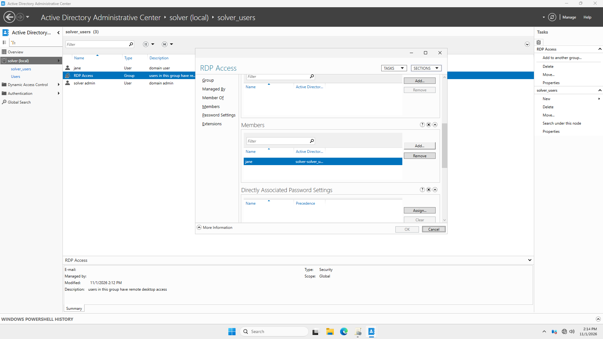
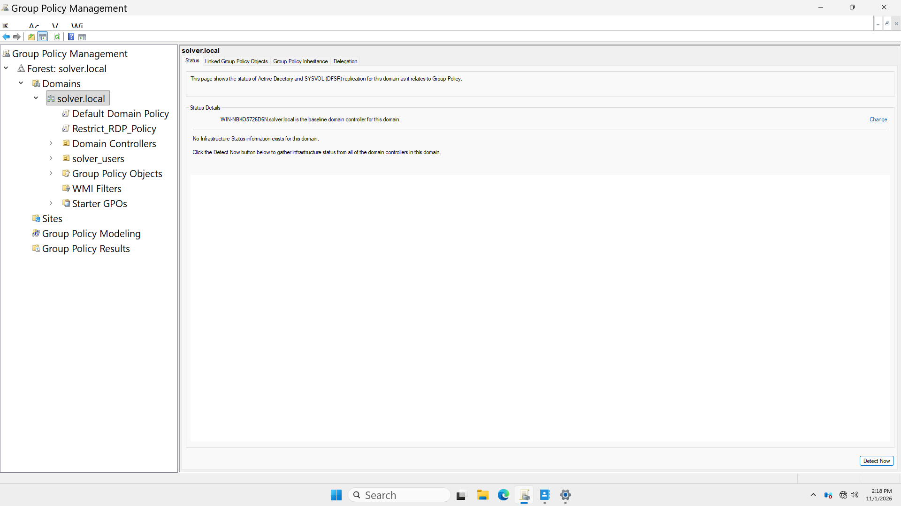
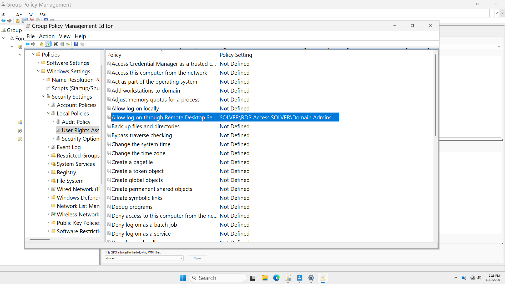
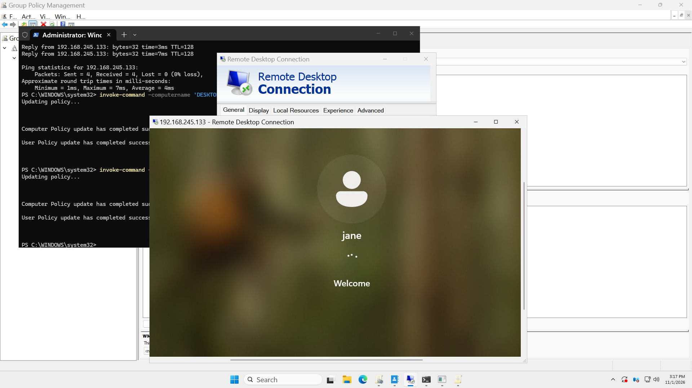
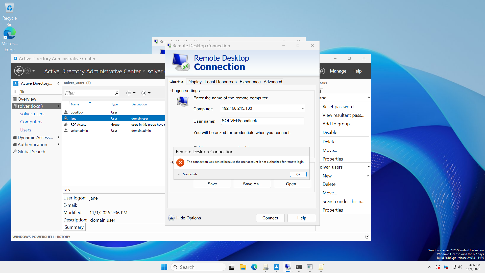

# Active Directory Lab: DC Deployment, IAM, & GPO Hardening

## Executive Summary
This project documents an enterprise Active Directory deployment built under the **Solver Cybertech** engineering lab. It tracks the complete lifecycle from Windows Server 2025 Domain Controller promotion and client workstation joining, to advanced identity management, security group scoping, and Group Policy Object (GPO) security hardening for Remote Desktop Protocol (RDP) access control.

---

## Technical Overview
* **Domain Name:** `solver.local`
* **Domain Controller OS:** Windows Server 2025 Standard Evaluation
* **Domain Controller IP:** `192.168.245.162` (Static)
* **Client OS:** Windows Workstation (Domain-Joined)
* **Identity Schema:** Custom OU (`solver_users`), Standard Users (`jane`, `goodluck`), & Security Groups (`rdp access`)

---

## Deployment & Execution Phases

### Phase 1: Core DC Infrastructure & Domain Join
* Promoted host to Primary Domain Controller (`solver.local`) with localized DNS authority (`127.0.0.1`).
* Configured client DNS to target the DC (`192.168.245.162`) and completed the workstation domain join.

---

### Phase 2: IAM Structuring & RBAC Security Groups
1. Established the `solver_users` Organizational Unit (OU).
2. Provisioned standard domain user accounts (`jane`, `goodluck`) and administrative accounts (`solver admin`).
3. Created the **`rdp access`** Global Security Group and assigned `jane` as a member to enforce Role-Based Access Control (RBAC).

---

### Phase 3: GPO Security Hardening (Least-Privilege RDP Enforcement)
To restrict lateral movement and prevent unauthorized remote access, generic RDP permissions were revoked enterprise-wide via Group Policy.

1. **GPO Creation:** Created and linked the `Restrict_RDP_Policy` GPO at the domain root level.
2. **User Rights Assignment:** Modified *Allow log on through Remote Desktop Services* policy setting to grant explicit rights **ONLY** to `SOLVER\Domain Admins` and `SOLVER\rdp access`.
3. **Policy Enforcement:** Forced group policy updates (`gpupdate /force`) across domain hosts.

---

### Phase 4: Access Control Validation & Proof-of-Concept Testing

* **Positive Control (Authorized User `jane`):** RDP authentication succeeded due to explicit membership in `SOLVER\rdp access`.
* **Negative Control (Unauthorized User `goodluck`):** RDP authentication was explicitly denied by system security policy, generating an access restriction error.

---

## Key Defensive Takeaways
* **Least Privilege Enforcement:** Restricting RDP via GPO User Rights Assignment ensures standard domain users cannot arbitrarily initiate remote sessions without explicit security group authorization.
* **Negative Security Verification:** Validating policy enforcement with an unauthorized account (`goodluck`) confirms that security baselines are actively restricting access as intended.

---

## Author
**Peter Okonkwo**  
Lead Engineer @ Solver Cybertech  
* GitHub: [github.com/solver113](https://github.com/solver113)  
* LinkedIn: [peter-okonkwo-3b6610230](https://www.linkedin.com/in/peter-okonkwo-3b6610230)
