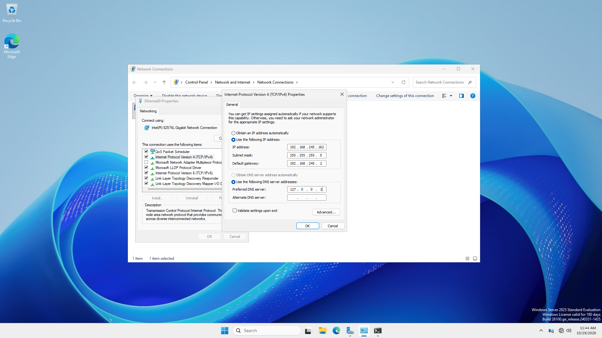
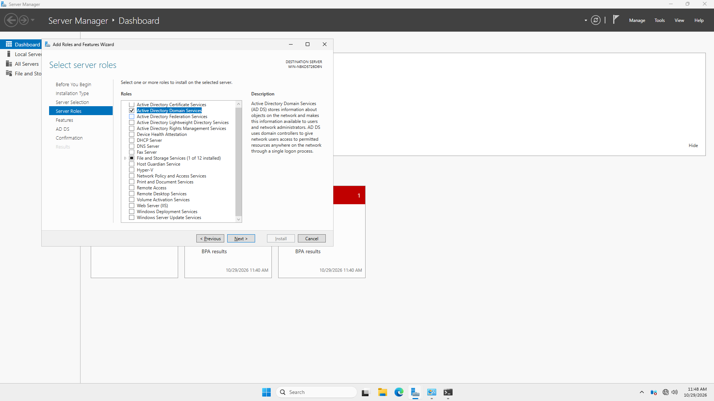
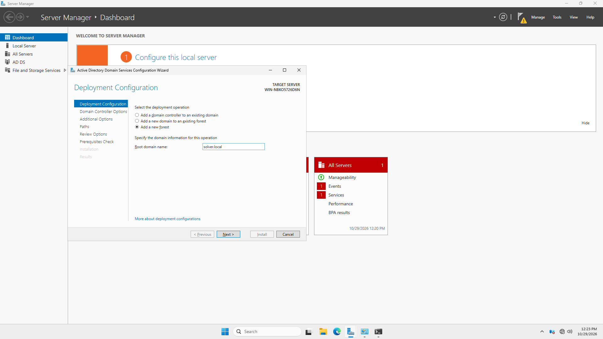
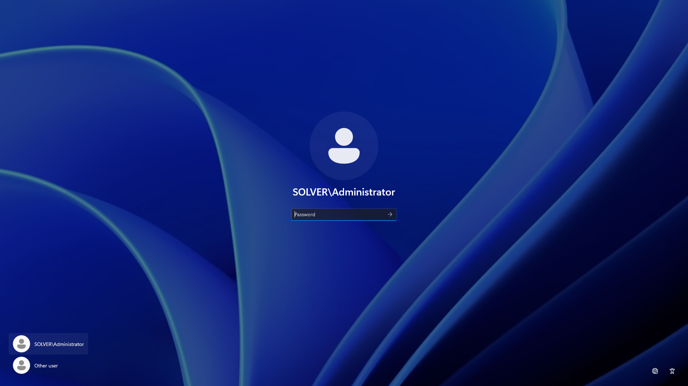
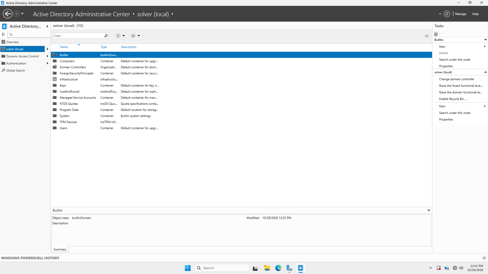
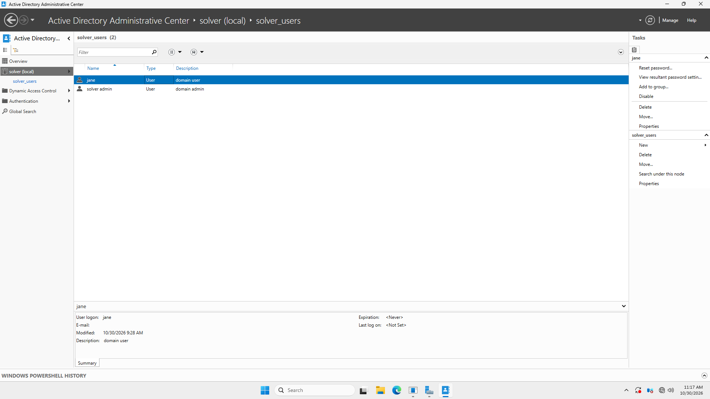
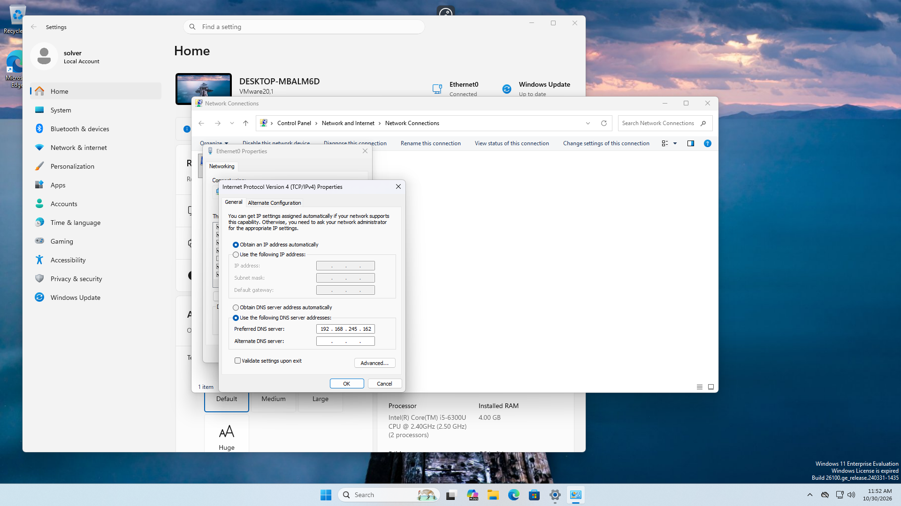
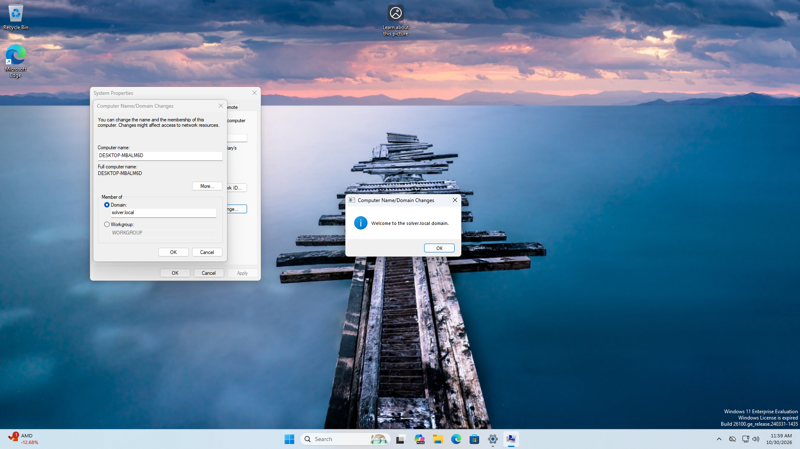
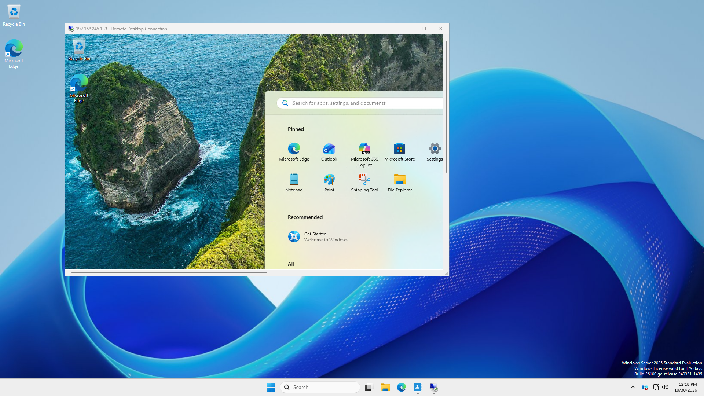

# Active Directory Lab: Domain Controller Deployment & Workstation Integration

## Executive Summary
This project documents the deployment of an enterprise Active Directory identity and access environment built under the **Solver Cybertech** lab framework. The infrastructure features a Windows Server 2025 Domain Controller managing domain authority, customized Organizational Units (OUs), Role-Based Access Control (RBAC) account structures, domain-joined client workstations, and secure Remote Desktop Protocol (RDP) connectivity.

---

## Technical Overview
* **Domain Name:** `solver.local`
* **Domain Controller OS:** Windows Server 2025 Standard Evaluation
* **Domain Controller IP:** `192.168.245.162` (Static)
* **Default Gateway:** `192.168.245.2`
* **Preferred DNS:** `127.0.0.1` (Loopback)
* **Client OS:** Windows Workstation (Domain-Joined)
* **Identity Schema:** Custom OUs (`solver_users`), Standard Domain Users, & Tiered Domain Admins

---

## Deployment & Execution Steps

### Phase 1: Network Staging & Static IP Binding
To establish persistent domain authority and avoid DNS failures, static TCP/IPv4 parameters were configured on the server prior to role promotion.

* Configured static IPv4 addressing (`192.168.245.162`).
* Bounded preferred DNS to `127.0.0.1` for local Active Directory resolution.

---

### Phase 2: Role Installation & Forest Promotion
1. Installed **Active Directory Domain Services (AD DS)** and DNS server roles via Server Manager.
2. Promoted the host to a Primary Domain Controller for the root forest `solver.local`.
3. Validated post-promotion administration via `SOLVER\Administrator`.

---

### Phase 3: Identity & Access Management (IAM) Structuring
To enforce least privilege and clear administrative boundaries, a dedicated Organizational Unit structure was established:
* Created custom OU: `solver_users`.
* Provisioned standard unprivileged domain account (`jane`).
* Provisioned administrative account (`solver admin`) assigned to the `Domain Admins` security group.

---

### Phase 4: Workstation Domain Join & Connectivity
1. Configured the client workstation's network interface with static DNS pointing directly to the Domain Controller (`192.168.245.162`).
2. Initiated domain join operation to `solver.local` using authorized administrative credentials.
3. Successfully authenticated and established domain membership.

---

### Phase 5: Remote Desktop Protocol (RDP) Verification
* Enabled Remote Desktop administrative access across domain hosts.
* Executed cross-network RDP authentication from the client workstation using domain credentials (`solver admin`).
* Verified session establishment, user profile generation, and network path viability.

---

## Key Security Takeaways
* **DNS Resolution is Paramount:** Client domain joins fail if workstation DNS isn't explicitly pointed to the DC's IP address.
* **Privilege Separation:** Establishing segregated OUs (`solver_users`) allows granular Group Policy Object (GPO) application and RBAC enforcement across standard vs. administrative accounts.
* **Remote Management:** Securing network access over RDP enables administrative flexibility while laying the baseline for future audit logging and SecOps traffic inspection.

---

## Author
**Peter Okonkwo**  
Lead Engineer @ Solver Cybertech  
* GitHub: [github.com/solver113](https://github.com/solver113)  
* LinkedIn: [peter-okonkwo-3b6610230](https://www.linkedin.com/in/peter-okonkwo-3b6610230)
